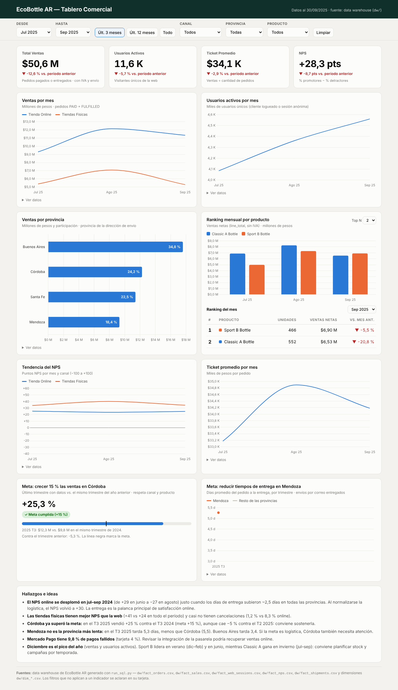

# EcoBottle AR — Mini ecosistema de datos comercial

Trabajo práctico de **Introducción al Marketing Online y los Negocios Digitales**.
A partir de los datos de origen de EcoBottle AR (carpeta `raw/`) se arma un **data warehouse con modelo estrella (Kimball)** en DuckDB y un **tablero comercial** publicado en GitHub Pages que lee las tablas de `dw/`.

- **Tablero en línea:** https://ramirocoletto.github.io/practica-imond/
- **Diagrama completo del modelo:** [`dw/modelo_estrella.md`](./dw/modelo_estrella.md)
- **Diagrama de las tablas de origen:** [`assets/DER.png`](./assets/DER.png)



---

## Contenido

1. [Estructura del repositorio](#estructura-del-repositorio)
2. [Instrucciones de ejecución](#instrucciones-de-ejecución)
3. [Modelo estrella](#modelo-estrella)
4. [Supuestos](#supuestos)
5. [Diccionario de datos](#diccionario-de-datos)
6. [Consultas clave (KPIs)](#consultas-clave-kpis)
7. [Tablero](#tablero)
8. [Hallazgos](#hallazgos)
9. [Convenciones del repositorio](#convenciones-del-repositorio)

---

## Estructura del repositorio

```
raw/                  datos de origen: un CSV por tabla (no se modifican)
sql/
  01_dimensiones.sql  10 dimensiones (CREATE TABLE + INSERT ... SELECT)
  02_hechos.sql       6 tablas de hechos con PRIMARY KEY y FOREIGN KEY
  03_consultas.sql    controles de calidad + KPIs + metas y hallazgos
run_sql.py            arma el data warehouse ejecutando sql/ y exporta a dw/
dw/                   el data warehouse en CSV (lo que lee el tablero) + diagrama
dashboard/index.html  el tablero (HTML + Chart.js), publicado con GitHub Pages
index.html            redirige la raíz del sitio al tablero
assets/               DER de origen y captura del tablero
requirements.txt      dependencias (DuckDB)
generator/            programa del profesor que generó los datos de raw/
```

## Instrucciones de ejecución

Requisitos: Python 3.9+ y Git.

```bash
# 1. Clonar el fork
git clone https://github.com/ramirocoletto/practica-imond.git
cd practica-imond

# 2. Crear y activar el entorno virtual
python3 -m venv .venv
source .venv/bin/activate          # Windows: .venv\Scripts\activate

# 3. Instalar dependencias
pip install -r requirements.txt

# 4. Armar el data warehouse (crea warehouse.duckdb y regenera dw/)
python run_sql.py
```

`run_sql.py` borra y vuelve a crear la base, ejecuta `sql/01_…`, `02_…` y `03_…` en orden, muestra en la terminal el resultado de cada consulta de `03_consultas.sql`, exporta cada tabla a `dw/<tabla>.csv` y dibuja el modelo en `dw/modelo_estrella.md`.

Otros modos:

```bash
python run_sql.py --explorar   # abre DuckDB en el navegador solo con las tablas raw
python run_sql.py --ui         # arma el DW y abre DuckDB con las tablas del modelo
```

### Ver el tablero en la computadora

El tablero lee los CSV de `dw/`, por eso necesita un servidor (abrir el HTML con doble clic no funciona por seguridad del navegador):

```bash
python -m http.server 8000
# abrir http://localhost:8000/
```

### Publicarlo en GitHub Pages

En el repositorio de GitHub: **Settings → Pages → Build and deployment → Source: Deploy from a branch → Branch: `main` / `(root)` → Save**. A los minutos queda en `https://ramirocoletto.github.io/practica-imond/`. Cada vez que se corre `run_sql.py` y se hace `git push`, el tablero muestra los datos nuevos.

## Modelo estrella

Seis tablas de hechos comparten las dimensiones (constelación de hechos / *bus matrix* de Kimball). Las dimensiones usan **claves subrogadas** (`*_key`) y guardan la **clave natural** del origen (`*_id`). La fecha usa una clave inteligente `AAAAMMDD`.

```mermaid
erDiagram
    dim_channel ||--o{ fact_nps : "channel_key"
    dim_channel ||--o{ fact_orders : "channel_key"
    dim_channel ||--o{ fact_payments : "channel_key"
    dim_channel ||--o{ fact_sales : "channel_key"
    dim_channel ||--o{ fact_shipments : "channel_key"
    dim_channel ||--o{ fact_web_sessions : "channel_key"
    dim_customer ||--o{ fact_nps : "customer_key"
    dim_customer ||--o{ fact_orders : "customer_key"
    dim_customer ||--o{ fact_payments : "customer_key"
    dim_customer ||--o{ fact_sales : "customer_key"
    dim_customer ||--o{ fact_shipments : "customer_key"
    dim_customer ||--o{ fact_web_sessions : "customer_key"
    dim_date ||--o{ fact_nps : "date_key"
    dim_date ||--o{ fact_orders : "date_key"
    dim_date ||--o{ fact_payments : "order_date_key"
    dim_date ||--o{ fact_payments : "paid_date_key"
    dim_date ||--o{ fact_sales : "date_key"
    dim_date ||--o{ fact_shipments : "delivered_date_key"
    dim_date ||--o{ fact_shipments : "order_date_key"
    dim_date ||--o{ fact_shipments : "shipped_date_key"
    dim_date ||--o{ fact_web_sessions : "date_key"
    dim_device ||--o{ fact_web_sessions : "device_key"
    dim_order_status ||--o{ fact_orders : "status_key"
    dim_order_status ||--o{ fact_sales : "status_key"
    dim_payment_method ||--o{ fact_orders : "payment_method_key"
    dim_payment_method ||--o{ fact_payments : "payment_method_key"
    dim_product ||--o{ fact_sales : "product_key"
    dim_province ||--o{ fact_orders : "province_key"
    dim_province ||--o{ fact_sales : "province_key"
    dim_province ||--o{ fact_shipments : "province_key"
    dim_store ||--o{ fact_orders : "store_key"
    dim_store ||--o{ fact_sales : "store_key"
    dim_store ||--o{ fact_shipments : "store_key"
    dim_traffic_source ||--o{ fact_web_sessions : "source_key"
```



| Hecho | Grano (una fila =) | Métricas principales | Dimensiones |
|---|---|---|---|
| `fact_sales` | un producto dentro de un pedido | quantity, line_total, total_amount_allocated | fecha, producto, cliente, canal, tienda, provincia, estado |
| `fact_orders` | un pedido | total_amount, subtotal, tax_amount, shipping_fee, units | fecha, cliente, canal, tienda, provincia, estado, medio de pago |
| `fact_payments` | un pago | amount, minutes_to_pay | fecha de pedido y de cobro, medio de pago, cliente, canal |
| `fact_shipments` | un envío por correo | hours_to_ship, days_in_transit, days_to_deliver | fecha de pedido / despacho / entrega, cliente, canal, tienda, provincia |
| `fact_web_sessions` | una visita a la web | active_user_id, duration_seconds | fecha, cliente, canal, origen, dispositivo |
| `fact_nps` | una respuesta NPS | score, nps_points, is_promoter, is_detractor | fecha, cliente, canal |

**Matriz de dimensiones compartidas** (✓ = el hecho usa la dimensión):

| | fecha | canal | provincia | producto | tienda | cliente | estado | medio de pago | origen | dispositivo |
|---|:-:|:-:|:-:|:-:|:-:|:-:|:-:|:-:|:-:|:-:|
| `fact_sales` | ✓ | ✓ | ✓ | ✓ | ✓ | ✓ | ✓ | | | |
| `fact_orders` | ✓ | ✓ | ✓ | | ✓ | ✓ | ✓ | ✓ | | |
| `fact_payments` | ✓ | ✓ | | | | ✓ | | ✓ | | |
| `fact_shipments` | ✓ | ✓ | ✓ | | ✓ | ✓ | | | | |
| `fact_web_sessions` | ✓ | ✓ | | | | ✓ | | | ✓ | ✓ |
| `fact_nps` | ✓ | ✓ | | | | ✓ | | | | |

## Supuestos

1. **Qué es una venta:** solo los pedidos con estado `PAID` o `FULFILLED` (regla de la consigna). Los hechos guardan **todos** los pedidos y marcan `is_sale`, para poder analizar también cancelaciones y reembolsos.
2. **Montos:** `total_amount` incluye IVA (21 %) y costo de envío; `line_total` es neto, sin IVA. "Total Ventas" y "Ticket Promedio" usan `total_amount`; el "Ranking por producto" usa `line_total`, como pide la consigna.
3. **Ventas filtradas por producto:** un pedido puede tener los dos productos. Para filtrar "Ventas" por producto sin cambiar su definición, `fact_sales.total_amount_allocated` reparte el `total_amount` del pedido entre sus líneas en proporción a `line_total`. La suma por pedido da exactamente el total (se verifica en `03_consultas.sql`, control A2).
4. **Provincia de una venta:** la de la **dirección de envío** (`shipping_address_id → address.province_id`). En compras en tienda es la dirección de la tienda.
5. **Usuarios activos:** `COUNT(DISTINCT active_user_id)`, donde `active_user_id` es `C-<customer_id>` si la persona inició sesión y `S-<session_id>` si es anónima (cada sesión anónima cuenta como un usuario). Las sesiones web pertenecen al canal ONLINE y no tienen provincia ni producto.
6. **NPS:** `(%9-10 − %0-6) × 100`. Se guarda `nps_points` (+100 / 0 / −100) para que el NPS de cualquier corte sea `AVG(nps_points)`. La encuesta no tiene pedido asociado: se analiza por canal y fecha de respuesta, no por provincia ni producto.
7. **Datos faltantes:** en lugar de FKs nulas se usa la fila **−1** ("Anónimo", "Online (sin tienda)", "Sin dato") en `dim_customer`, `dim_store`, `dim_traffic_source` y `dim_device`. Las fechas opcionales (`paid_date_key`, `shipped_date_key`, `delivered_date_key`) quedan en NULL cuando el evento no ocurrió.
8. **Fechas:** la foto del sistema es del 30/09/2025 23:59:59, hora de Argentina. `dim_date` cubre del 01/01/2024 al 30/09/2025; el último trimestre (2025-T3) está completo.
9. **Tiempos de entrega:** se miden del pedido a la entrega (`days_to_deliver`), solo para envíos `DELIVERED`, y se asignan al trimestre de la fecha del pedido.
10. **Meta Córdoba (+15 %):** se compara el último trimestre (2025-T3) contra el mismo trimestre del año anterior (2024-T3), para no mezclar estacionalidad; también se muestra la variación contra el trimestre anterior.
11. **Tablero en GitHub Pages en lugar de Looker Studio / Power BI:** se trabaja en Mac (Power BI Desktop no existe para macOS). El tablero es una página estática que lee directamente los CSV de `dw/`, así cumple que la fuente sea el data warehouse.

## Diccionario de datos

Tipos tal como quedan en DuckDB. PK = clave primaria, FK = clave foránea.

#### `dim_date`

Calendario día a día (01/01/2024 – 30/09/2025). Una fila por día.

| Columna | Tipo | Clave | Descripción / dominio |
|---|---|---|---|
| `date_key` | INTEGER | PK | Clave AAAAMMDD (ej. 20240131) |
| `full_date` | DATE |  | Fecha |
| `year` | INTEGER |  | Año |
| `quarter` | INTEGER |  | Trimestre 1–4 |
| `year_quarter` | VARCHAR |  | Ej. 2025-T3 |
| `month` | INTEGER |  | Mes 1–12 |
| `month_name` | VARCHAR |  | Enero…Diciembre |
| `year_month` | VARCHAR |  | Ej. 2025-09 |
| `month_start` | DATE |  | Primer día del mes (equivale a DATE_TRUNC) |
| `iso_week` | INTEGER |  | Semana ISO |
| `day_of_month` | INTEGER |  | Día 1–31 |
| `day_of_week` | INTEGER |  | 1 = lunes … 7 = domingo |
| `day_name` | VARCHAR |  | Lunes…Domingo |
| `is_weekend` | BOOLEAN |  | Sábado o domingo |

#### `dim_channel`

Canal de venta. Una fila por canal.

| Columna | Tipo | Clave | Descripción / dominio |
|---|---|---|---|
| `channel_key` | INTEGER | PK | Clave subrogada |
| `channel_id` | INTEGER |  | Clave natural (raw.channel) |
| `code` | VARCHAR |  | ONLINE / OFFLINE |
| `name` | VARCHAR |  | Tienda Online / Tiendas Físicas |

#### `dim_province`

Provincia. Una fila por provincia.

| Columna | Tipo | Clave | Descripción / dominio |
|---|---|---|---|
| `province_key` | INTEGER | PK | Clave subrogada |
| `province_id` | INTEGER |  | Clave natural (raw.province) |
| `name` | VARCHAR |  | Buenos Aires, Córdoba, Santa Fe, Mendoza |
| `code` | VARCHAR |  | BA / CBA / SF / MZA |
| `iso_3166_2` | VARCHAR |  | Código ISO para mapas (AR-B, AR-X, AR-S, AR-M) |

#### `dim_product`

Producto con la jerarquía de categorías aplanada. Una fila por producto.

| Columna | Tipo | Clave | Descripción / dominio |
|---|---|---|---|
| `product_key` | INTEGER | PK | Clave subrogada |
| `product_id` | INTEGER |  | Clave natural (raw.product) |
| `sku` | VARCHAR |  | Código de producto |
| `name` | VARCHAR |  | Classic A Bottle / Sport B Bottle |
| `category` | VARCHAR |  | Classic / Sport |
| `family` | VARCHAR |  | Bottles (categoría padre) |
| `list_price` | DECIMAL(12,2) |  | Precio de lista sin IVA |
| `status` | VARCHAR |  | Activo / Inactivo |

#### `dim_store`

Tienda física con su dirección aplanada. Fila −1 = pedidos online (sin tienda).

| Columna | Tipo | Clave | Descripción / dominio |
|---|---|---|---|
| `store_key` | INTEGER | PK | Clave subrogada (−1 = Online) |
| `store_id` | INTEGER |  | Clave natural (NULL en la fila −1) |
| `name` | VARCHAR |  | Tienda BA, Tienda CBA, … |
| `address_line` | VARCHAR |  | Calle y número |
| `city` | VARCHAR |  | Ciudad |
| `province_name` | VARCHAR |  | Provincia de la tienda |
| `province_code` | VARCHAR |  | BA / CBA / SF / MZA |

#### `dim_customer`

Cliente. Fila −1 = anónimo (NPS sin cliente, sesiones sin login).

| Columna | Tipo | Clave | Descripción / dominio |
|---|---|---|---|
| `customer_key` | INTEGER | PK | Clave subrogada (−1 = anónimo) |
| `customer_id` | INTEGER |  | Clave natural (NULL en la fila −1) |
| `email` | VARCHAR |  | Email (único) |
| `first_name` | VARCHAR |  | Nombre |
| `last_name` | VARCHAR |  | Apellido |
| `full_name` | VARCHAR |  | Nombre y apellido |
| `phone` | VARCHAR |  | Teléfono (puede faltar) |
| `status_code` | VARCHAR |  | A / I (? en la fila −1) |
| `status` | VARCHAR |  | Activo / Inactivo (baja) / Desconocido |
| `created_at` | TIMESTAMP |  | Fecha y hora de alta |
| `created_date` | DATE |  | Fecha de alta |
| `cohort_month` | VARCHAR |  | Mes de alta AAAA-MM |

#### `dim_order_status`

Estado del pedido y regla de qué cuenta como venta.

| Columna | Tipo | Clave | Descripción / dominio |
|---|---|---|---|
| `status_key` | INTEGER | PK | Clave |
| `status_code` | VARCHAR |  | CREATED / PAID / FULFILLED / CANCELLED / REFUNDED |
| `description` | VARCHAR |  | Descripción |
| `is_sale` | BOOLEAN |  | TRUE solo para PAID y FULFILLED |

#### `dim_payment_method`

Medio de pago.

| Columna | Tipo | Clave | Descripción / dominio |
|---|---|---|---|
| `payment_method_key` | INTEGER | PK | Clave |
| `method_code` | VARCHAR |  | CARD / GATEWAY / CASH / TRANSFER |
| `description` | VARCHAR |  | Tarjeta, Mercado Pago, Efectivo, Transferencia |

#### `dim_traffic_source`

Origen de la visita web, agrupado por tipo de marketing.

| Columna | Tipo | Clave | Descripción / dominio |
|---|---|---|---|
| `source_key` | INTEGER | PK | Clave (−1 = sin dato) |
| `source_code` | VARCHAR |  | ads / direct / referral / organic |
| `description` | VARCHAR |  | Descripción |
| `marketing_type` | VARCHAR |  | Pago / Propio / Ganado |

#### `dim_device`

Dispositivo de la visita web.

| Columna | Tipo | Clave | Descripción / dominio |
|---|---|---|---|
| `device_key` | INTEGER | PK | Clave (−1 = sin dato) |
| `device_code` | VARCHAR |  | mobile / desktop / tablet |
| `description` | VARCHAR |  | Celular / Computadora / Tablet |

#### `fact_sales`

**Grano: una línea de pedido** (un producto dentro de un pedido). Origen: `sales_order_item` + `sales_order`.

| Columna | Tipo | Clave | Descripción / dominio |
|---|---|---|---|
| `order_item_id` | BIGINT | PK | Clave natural de la línea |
| `order_id` | BIGINT |  | Número de pedido (dimensión degenerada) |
| `date_key` | INTEGER | FK → dim_date | Fecha del pedido |
| `product_key` | INTEGER | FK → dim_product | Producto |
| `customer_key` | INTEGER | FK → dim_customer | Cliente |
| `channel_key` | INTEGER | FK → dim_channel | Canal |
| `store_key` | INTEGER | FK → dim_store | Tienda (−1 = online) |
| `province_key` | INTEGER | FK → dim_province | Provincia de la dirección de envío |
| `status_key` | INTEGER | FK → dim_order_status | Estado del pedido |
| `is_sale` | BOOLEAN |  | El pedido cuenta como venta |
| `quantity` | INTEGER |  | Unidades (> 0) |
| `unit_price` | DECIMAL(12,2) |  | Precio unitario sin IVA |
| `gross_amount` | DECIMAL(12,2) |  | quantity × unit_price |
| `discount_amount` | DECIMAL(12,2) |  | Descuento de la línea |
| `line_total` | DECIMAL(12,2) |  | gross_amount − discount_amount (sin IVA) |
| `total_amount_allocated` | DECIMAL(12,2) |  | Total del pedido (con IVA y envío) repartido en proporción a line_total |

#### `fact_orders`

**Grano: un pedido.** Origen: `sales_order` (+ `payment`, `shipment`, `sales_order_item`).

| Columna | Tipo | Clave | Descripción / dominio |
|---|---|---|---|
| `order_id` | BIGINT | PK | Clave natural del pedido |
| `date_key` | INTEGER | FK → dim_date | Fecha del pedido |
| `customer_key` | INTEGER | FK → dim_customer | Cliente |
| `channel_key` | INTEGER | FK → dim_channel | Canal |
| `store_key` | INTEGER | FK → dim_store | Tienda (−1 = online) |
| `province_key` | INTEGER | FK → dim_province | Provincia de la dirección de envío |
| `status_key` | INTEGER | FK → dim_order_status | Estado |
| `payment_method_key` | INTEGER | FK → dim_payment_method | Medio de pago (1 pago por pedido) |
| `is_sale` | BOOLEAN |  | PAID o FULFILLED |
| `has_shipment` | BOOLEAN |  | Viajó por correo |
| `item_lines` | INTEGER |  | Cantidad de líneas |
| `units` | INTEGER |  | Unidades totales |
| `subtotal` | DECIMAL(12,2) |  | Suma de line_total (sin IVA) |
| `discount_amount` | DECIMAL(12,2) |  | Descuentos del pedido |
| `tax_amount` | DECIMAL(12,2) |  | IVA 21 % |
| `shipping_fee` | DECIMAL(12,2) |  | Costo de envío |
| `total_amount` | DECIMAL(12,2) |  | subtotal + IVA + envío |

#### `fact_payments`

**Grano: un pago.** Origen: `payment`.

| Columna | Tipo | Clave | Descripción / dominio |
|---|---|---|---|
| `payment_id` | BIGINT | PK | Clave natural del pago |
| `order_id` | BIGINT |  | Pedido (dimensión degenerada) |
| `order_date_key` | INTEGER | FK → dim_date | Fecha del pedido |
| `paid_date_key` | INTEGER | FK → dim_date | Fecha de cobro (NULL si no se cobró) |
| `payment_method_key` | INTEGER | FK → dim_payment_method | Medio de pago |
| `customer_key` | INTEGER | FK → dim_customer | Cliente |
| `channel_key` | INTEGER | FK → dim_channel | Canal |
| `payment_status` | VARCHAR |  | PENDING / PAID / FAILED / REFUNDED |
| `transaction_ref` | VARCHAR |  | Referencia de la transacción |
| `amount` | DECIMAL(12,2) |  | Importe |
| `minutes_to_pay` | INTEGER |  | Minutos entre el pedido y el cobro |

#### `fact_shipments`

**Grano: un envío por correo.** Origen: `shipment`.

| Columna | Tipo | Clave | Descripción / dominio |
|---|---|---|---|
| `shipment_id` | BIGINT | PK | Clave natural del envío |
| `order_id` | BIGINT |  | Pedido (dimensión degenerada) |
| `order_date_key` | INTEGER | FK → dim_date | Fecha del pedido |
| `shipped_date_key` | INTEGER | FK → dim_date | Fecha de despacho |
| `delivered_date_key` | INTEGER | FK → dim_date | Fecha de entrega |
| `customer_key` | INTEGER | FK → dim_customer | Cliente |
| `channel_key` | INTEGER | FK → dim_channel | Canal |
| `store_key` | INTEGER | FK → dim_store | Tienda que despacha (−1 = online) |
| `province_key` | INTEGER | FK → dim_province | Provincia de destino |
| `carrier` | VARCHAR |  | Correo |
| `tracking_number` | VARCHAR |  | Número de seguimiento |
| `shipment_status` | VARCHAR |  | READY / SHIPPED / DELIVERED / CANCELLED |
| `is_delivered` | BOOLEAN |  | Se entregó |
| `hours_to_ship` | DECIMAL(8,2) |  | Horas del pedido al despacho |
| `days_in_transit` | DECIMAL(8,2) |  | Días del despacho a la entrega |
| `days_to_deliver` | DECIMAL(8,2) |  | Días del pedido a la entrega |

#### `fact_web_sessions`

**Grano: una visita a la web.** Origen: `web_session`.

| Columna | Tipo | Clave | Descripción / dominio |
|---|---|---|---|
| `session_id` | BIGINT | PK | Clave natural de la sesión |
| `date_key` | INTEGER | FK → dim_date | Fecha de inicio |
| `customer_key` | INTEGER | FK → dim_customer | Cliente (−1 = sin login) |
| `channel_key` | INTEGER | FK → dim_channel | Siempre ONLINE |
| `source_key` | INTEGER | FK → dim_traffic_source | Origen de la visita |
| `device_key` | INTEGER | FK → dim_device | Dispositivo |
| `active_user_id` | VARCHAR |  | 'C-<cliente>' si inició sesión, 'S-<sesión>' si es anónimo |
| `is_logged_in` | BOOLEAN |  | Inició sesión |
| `duration_seconds` | INTEGER |  | Duración (NULL si no tiene fin) |

#### `fact_nps`

**Grano: una respuesta NPS.** Origen: `nps_response`.

| Columna | Tipo | Clave | Descripción / dominio |
|---|---|---|---|
| `nps_id` | BIGINT | PK | Clave natural de la respuesta |
| `date_key` | INTEGER | FK → dim_date | Fecha de respuesta |
| `customer_key` | INTEGER | FK → dim_customer | Cliente (−1 = anónimo) |
| `channel_key` | INTEGER | FK → dim_channel | Canal |
| `score` | SMALLINT |  | Puntaje 0–10 |
| `nps_category` | VARCHAR |  | Promotor (9–10) / Pasivo (7–8) / Detractor (0–6) |
| `is_promoter` | INTEGER |  | 1 si es promotor |
| `is_passive` | INTEGER |  | 1 si es pasivo |
| `is_detractor` | INTEGER |  | 1 si es detractor |
| `nps_points` | INTEGER |  | +100 / 0 / −100 → NPS = AVG(nps_points) |
| `has_comment` | BOOLEAN |  | Dejó comentario |
| `comment` | VARCHAR |  | Comentario libre |

## Consultas clave (KPIs)

Todas están en [`sql/03_consultas.sql`](./sql/03_consultas.sql) y se calculan **solo con el modelo estrella**. Resultados sobre todo el período (01/2024 – 09/2025):

| KPI | Resultado |
|---|---|
| Total Ventas | **$382,4 M** (online $227,0 M · tiendas $155,4 M) |
| Usuarios Activos | **73,8 K** usuarios únicos |
| Ticket Promedio | **$34,8 K** (online $35,2 K · tiendas $34,2 K) |
| NPS | **+30,0** (online +24,0 · tiendas +40,9) |
| Ventas por provincia | Buenos Aires 37,3 % · Córdoba 23,4 % · Santa Fe 22,9 % · Mendoza 16,4 % |

**$M Total Ventas**
```sql
SELECT SUM(f.total_amount) / 1e6 AS ventas_millones
FROM fact_orders AS f
WHERE f.is_sale;                       -- PAID + FULFILLED
```

**nK Usuarios Activos (por mes)**
```sql
SELECT d.year_month, COUNT(DISTINCT f.active_user_id) AS usuarios_activos
FROM fact_web_sessions AS f
JOIN dim_date AS d USING (date_key)
GROUP BY d.year_month
ORDER BY d.year_month;
```

**$K Ticket Promedio**
```sql
SELECT SUM(f.total_amount) / COUNT(*) AS ticket_promedio
FROM fact_orders AS f
WHERE f.is_sale;
```

**NPS por canal**
```sql
SELECT c.name AS canal,
       (SUM(f.is_promoter) - SUM(f.is_detractor)) * 100.0 / COUNT(*) AS nps
FROM fact_nps AS f
JOIN dim_channel AS c USING (channel_key)
GROUP BY c.name;
```

**Ventas por provincia**
```sql
SELECT p.name AS provincia, SUM(f.total_amount) AS ventas
FROM fact_orders AS f
JOIN dim_province AS p USING (province_key)
WHERE f.is_sale
GROUP BY p.name
ORDER BY ventas DESC;
```

**Ranking mensual por producto**
```sql
SELECT d.month_start AS mes,             -- = DATE_TRUNC('month', order_date)
       RANK() OVER (PARTITION BY d.month_start ORDER BY SUM(f.line_total) DESC) AS puesto,
       p.name AS producto,
       SUM(f.line_total) AS ventas_netas
FROM fact_sales AS f
JOIN dim_date AS d USING (date_key)
JOIN dim_product AS p USING (product_key)
WHERE f.is_sale
GROUP BY d.month_start, p.name
ORDER BY mes, puesto;
```

El archivo también tiene **controles de calidad** (filas del DW = filas de raw, ventas del DW = ventas calculadas en raw, cantidad de claves −1) y consultas para las **metas del trimestre** (crecimiento de Córdoba y días de entrega por provincia), tasa de cancelación por canal, conversión por origen de tráfico y fallas por medio de pago.

## Tablero

[`dashboard/index.html`](./dashboard/index.html) — HTML + [Chart.js](https://www.chartjs.org/) + [PapaParse](https://www.papaparse.com/), sin servidor. Lee `dw/fact_orders.csv`, `fact_sales.csv`, `fact_web_sessions.csv`, `fact_nps.csv`, `fact_shipments.csv` y las dimensiones de canal, provincia y producto.

**Filtros** (arriba, afectan a todo el tablero): período desde / hasta con atajos (últimos 3 y 12 meses, todo), canal, provincia y producto.

**Vistas:**

| Vista | Qué muestra |
|---|---|
| Tarjetas | Total Ventas ($M), Usuarios Activos (nK), Ticket Promedio ($K) y NPS (pts), con flecha de variación contra el período anterior de igual duración |
| Ventas por mes | Serie temporal por canal |
| Usuarios activos por mes | Serie temporal |
| Ventas por provincia | Barras con participación %; la provincia filtrada queda resaltada |
| Ranking mensual por producto | Barras por mes + tabla "Top N" del mes elegido con variación vs. el mes anterior |
| Tendencia del NPS | Serie mensual por canal |
| Ticket promedio por mes | Serie temporal |
| Metas del trimestre | Avance de Córdoba contra el +15 % y días de entrega por provincia con Mendoza resaltada |
| Hallazgos | Conclusiones del análisis |

Cada gráfico tiene "Ver datos" con la tabla de valores. Cuando un filtro no aplica a un indicador (por ejemplo, la provincia en usuarios activos o NPS), la tarjeta lo aclara. El tablero se adapta a celular y a modo oscuro.

## Hallazgos

- **El NPS online cayó a negativo en jul–sep 2024** (de +29 en junio a −27 en agosto), justo cuando los días de entrega subieron ~2,5 días en todas las provincias (Buenos Aires pasó de 3,7 a 6,5 días). Con la logística normalizada, el NPS volvió a +30: **la entrega es la principal palanca de satisfacción online.** Entre los comentarios de detractores aparecen sobre todo problemas de envío y producto ("Llegó con la caja dañada", "La tapa pierde líquido", "Tardó mucho más de lo esperado").
- **Las tiendas físicas tienen mejor NPS** (+41 vs +24) y casi no tienen cancelaciones (1,2 % vs 8,3 % online).
- **Córdoba ya superó la meta:** 2025-T3 vendió **+25,3 %** contra 2024-T3 (meta +15 %), aunque baja −5,3 % contra 2025-T2.
- **Mendoza no es la provincia más lenta:** en 2025-T3 tarda 5,3 días, contra 5,5 de Córdoba, 5,2 de Santa Fe y 3,4 de Buenos Aires. La meta logística debería incluir a Córdoba.
- **Mercado Pago tiene 9,8 % de pagos fallidos** (tarjeta 4,0 %): revisar la pasarela podría recuperar ventas online.
- **Estacionalidad:** diciembre es el pico de ventas y de usuarios activos; Sport B lidera en verano (dic–feb) y en junio, y Classic A en invierno (jul–sep).

## Convenciones del repositorio

- Entorno virtual `.venv` (ignorado por Git) + `requirements.txt`.
- `warehouse.duckdb` no se sube: se regenera con `python run_sql.py`. `dw/` sí se sube porque es la fuente del tablero.
- Commits con [Conventional Commits](https://www.conventionalcommits.org/es/): `feat:`, `fix:`, `docs:`, `chore:`, `refactor:`, por ejemplo `feat(sql): agregar dimensiones del modelo estrella`.
- Toda la gestión del repositorio se hace desde la terminal (`git add`, `git commit`, `git push`).
