# EcoBottle AR — Mini ecosistema de datos comercial

Trabajo práctico de **Introducción al Marketing Online y los Negocios Digitales**.
A partir de los datos de origen de EcoBottle AR (carpeta `raw/`) se arma un **data warehouse con modelo estrella (Kimball)** en DuckDB, una capa de **marts** (una tabla lista para cada visual) y un **tablero comercial** publicado en GitHub Pages que lee esos marts.

- **Tablero en línea:** https://ramirocoletto.github.io/practica-imond/
- **Diagrama completo del modelo:** [`dw/modelo_estrella.md`](./dw/modelo_estrella.md)
- **Diagrama de las tablas de origen:** [`assets/DER.png`](./assets/DER.png)


---

## Contenido

1. [Estructura del repositorio](#estructura-del-repositorio)
2. [Instrucciones de ejecución](#instrucciones-de-ejecución)
3. [Arquitectura por capas](#arquitectura-por-capas)
4. [Modelo estrella](#modelo-estrella)
5. [Supuestos](#supuestos)
6. [Diccionario de datos](#diccionario-de-datos)
7. [Consultas clave (KPIs) y validaciones](#consultas-clave-kpis-y-validaciones)
8. [Tablero](#tablero)
9. [Hallazgos](#hallazgos)
10. [Convenciones del repositorio](#convenciones-del-repositorio)

---

## Estructura del repositorio

```
raw/                  datos de origen: un CSV por tabla (no se modifican)
sql/
  01_dimensiones.sql  15 dimensiones (CREATE TABLE + INSERT ... SELECT)
  02_hechos.sql       6 tablas de hechos con PRIMARY KEY y FOREIGN KEY
  03_marts.sql        7 marts: una tabla lista para cada visual del tablero
  04_consultas.sql    validaciones + KPIs + metas y hallazgos
run_sql.py            arma el data warehouse ejecutando sql/ y exporta a dw/
dw/                   el data warehouse en CSV (dimensiones, hechos y marts) + diagrama
dashboard/index.html  el tablero (HTML + Chart.js), publicado con GitHub Pages
index.html            redirige la raíz del sitio al tablero
.nojekyll             le indica a GitHub Pages que publique los archivos tal cual
assets/               DER de origen (DER.png) y captura del tablero (dashboard.png)
requirements.txt      dependencias (DuckDB)
generator/            programa del profesor que generó los datos de raw/
```

## Instrucciones de ejecución

Requisitos: Python 3.9+ y Git.

```bash
# 1. Clonar el repositorio
git clone https://github.com/ramirocoletto/practica-imond.git
cd practica-imond

# 2. Crear y activar el entorno virtual
python3 -m venv .venv
source .venv/bin/activate          # Windows: .venv\Scripts\activate

# 3. Instalar dependencias
pip install -r requirements.txt

# 4. Armar el data warehouse (crea warehouse.duckdb y regenera dw/)
python run_sql.py
```

`run_sql.py` borra y vuelve a crear la base, ejecuta `sql/01_…` a `sql/04_…` en orden, muestra en la terminal el resultado de cada consulta de `04_consultas.sql` (validaciones y KPIs), exporta cada tabla a `dw/<tabla>.csv` y dibuja el modelo en `dw/modelo_estrella.md`. Correrlo dos veces da exactamente los mismos archivos.

Otros modos:

```bash
python run_sql.py --explorar   # abre DuckDB en el navegador solo con las tablas raw
python run_sql.py --ui         # arma el DW y abre DuckDB con las tablas del modelo
```

### Ver el tablero en la computadora

El tablero lee los CSV de `dw/`, por eso necesita un servidor (abrir el HTML con doble clic no funciona por seguridad del navegador):

```bash
python -m http.server 8000
# abrir http://localhost:8000/   (Ctrl + C para cortar)
```

### Publicarlo en GitHub Pages

**Settings → Pages → Build and deployment → Source: Deploy from a branch → Branch: `main` / `(root)` → Save**. Queda en `https://ramirocoletto.github.io/practica-imond/`. Cada vez que se corre `run_sql.py` y se hace `git push`, el tablero muestra los datos nuevos.

## Arquitectura por capas

```
raw/*.csv ──► 01_dimensiones.sql ─┐
              02_hechos.sql      ─┴► dim_* / fact_*  ──► 03_marts.sql ──► mart_*  ──► dashboard/index.html
              (ETL en SQL: joins,      modelo estrella      (agregación por mes,        (solo filtra filas,
               claves, reglas)                               joins con dimensiones,      suma columnas y
                                                             conteos distintos)          divide al final)
```

| Capa | Lee de | Qué hace |
|---|---|---|
| `dim_*` / `fact_*` | `raw.*` | Modelo estrella: claves subrogadas, miembros −1, reglas de negocio (qué es una venta, provincia de envío, usuario activo, categoría NPS) |
| `mart_*` | **solo** `fact_*` y `dim_*` | Una tabla por visual, ya unida con los nombres de sus dimensiones y agregada por mes, con medidas **aditivas** (sumas y conteos). El único conteo distinto (usuarios activos) se precalcula para cada rango de meses |
| Tablero | **solo** `mart_*` (+ `dim_channel`, `dim_province`, `dim_product` para llenar los filtros) | Filtra filas, suma columnas y hace la división final de un cociente, como una medida de Power BI / Looker Studio. No hace joins, ni conteos distintos, ni recorre tablas de hechos |

**Qué calcula el tablero** (todo dentro de "filtrar, sumar y dividir"):

| Indicador | Mart | Cálculo en el navegador |
|---|---|---|
| Total Ventas | `mart_ventas_mes` (o `mart_ventas_producto_mes` con producto) | `SUM(ventas)` de las filas filtradas |
| Ticket Promedio | ídem | `SUM(ventas) / SUM(pedidos)` |
| Usuarios Activos | `mart_usuarios_activos_rango` | Se lee la fila `desde_mes`–`hasta_mes` del filtro (sin sumar) |
| NPS | `mart_nps_mes` | `SUM(puntos_nps) / SUM(respuestas)` |
| Ventas por provincia | `mart_ventas_mes` | `SUM(ventas)` por provincia y su % sobre el total |
| Ranking por producto | `mart_ventas_producto_mes` | `SUM(ventas_netas)` por producto y mes, ordenado (Top N) |
| Variación vs. período anterior / meta Córdoba | `mart_ventas_mes` | Cociente de dos sumas − 1 |
| Días de entrega | `mart_entregas_mes` (o `_producto_mes`) | `SUM(suma_dias_entrega) / SUM(envios_entregados)` por provincia y trimestre |

## Modelo estrella

Seis tablas de hechos comparten las dimensiones (constelación de hechos / *bus matrix* de Kimball). Las dimensiones usan **claves subrogadas** (`*_key`) y guardan la **clave natural** del origen (`*_id`). La fecha usa una clave inteligente `AAAAMMDD`. Todas las FK se declaran en el `CREATE TABLE` (DuckDB no permite agregarlas con `ALTER TABLE`), por eso las dimensiones se crean primero.

```mermaid
erDiagram
    dim_address ||--o{ fact_orders : "billing_address_key"
    dim_address ||--o{ fact_orders : "shipping_address_key"
    dim_address ||--o{ fact_sales : "shipping_address_key"
    dim_address ||--o{ fact_shipments : "shipping_address_key"
    dim_carrier ||--o{ fact_shipments : "carrier_key"
    dim_channel ||--o{ fact_nps : "channel_key"
    dim_channel ||--o{ fact_orders : "channel_key"
    dim_channel ||--o{ fact_payments : "channel_key"
    dim_channel ||--o{ fact_sales : "channel_key"
    dim_channel ||--o{ fact_shipments : "channel_key"
    dim_channel ||--o{ fact_web_sessions : "channel_key"
    dim_customer ||--o{ fact_nps : "customer_key"
    dim_customer ||--o{ fact_orders : "customer_key"
    dim_customer ||--o{ fact_payments : "customer_key"
    dim_customer ||--o{ fact_sales : "customer_key"
    dim_customer ||--o{ fact_shipments : "customer_key"
    dim_customer ||--o{ fact_web_sessions : "customer_key"
    dim_date ||--o{ fact_nps : "date_key"
    dim_date ||--o{ fact_orders : "date_key"
    dim_date ||--o{ fact_payments : "order_date_key"
    dim_date ||--o{ fact_payments : "paid_date_key"
    dim_date ||--o{ fact_sales : "date_key"
    dim_date ||--o{ fact_shipments : "delivered_date_key"
    dim_date ||--o{ fact_shipments : "order_date_key"
    dim_date ||--o{ fact_shipments : "shipped_date_key"
    dim_date ||--o{ fact_web_sessions : "date_key"
    dim_device ||--o{ fact_web_sessions : "device_key"
    dim_nps_category ||--o{ fact_nps : "nps_category_key"
    dim_order_status ||--o{ fact_orders : "status_key"
    dim_order_status ||--o{ fact_sales : "status_key"
    dim_payment_method ||--o{ fact_orders : "payment_method_key"
    dim_payment_method ||--o{ fact_payments : "payment_method_key"
    dim_payment_status ||--o{ fact_payments : "payment_status_key"
    dim_product ||--o{ fact_sales : "product_key"
    dim_province ||--o{ fact_orders : "province_key"
    dim_province ||--o{ fact_sales : "province_key"
    dim_province ||--o{ fact_shipments : "province_key"
    dim_shipment_status ||--o{ fact_shipments : "shipment_status_key"
    dim_store ||--o{ fact_orders : "store_key"
    dim_store ||--o{ fact_sales : "store_key"
    dim_store ||--o{ fact_shipments : "store_key"
    dim_traffic_source ||--o{ fact_web_sessions : "source_key"
```



| Hecho | Grano (una fila =) | Métricas principales |
|---|---|---|
| `fact_sales` | un producto dentro de un pedido | quantity, line_total, total_amount_allocated |
| `fact_orders` | un pedido | total_amount, subtotal, tax_amount, shipping_fee, units |
| `fact_payments` | un pago | amount, minutes_to_pay |
| `fact_shipments` | un envío por correo | hours_to_ship, days_in_transit, days_to_deliver |
| `fact_web_sessions` | una visita a la web | duration_seconds (y active_user_id para el conteo distinto) |
| `fact_nps` | una respuesta NPS | score, nps_points, is_promoter, is_detractor |

**Matriz de dimensiones compartidas** (✓ = el hecho usa la dimensión):

| | fecha | canal | provincia | dirección | producto | tienda | cliente | estado pedido | medio de pago | estado pago | estado envío | correo | origen | dispositivo | categoría NPS |
|---|:-:|:-:|:-:|:-:|:-:|:-:|:-:|:-:|:-:|:-:|:-:|:-:|:-:|:-:|:-:|
| `fact_sales` | ✓ | ✓ | ✓ | ✓ | ✓ | ✓ | ✓ | ✓ | | | | | | | |
| `fact_orders` | ✓ | ✓ | ✓ | ✓ (envío y facturación) | | ✓ | ✓ | ✓ | ✓ | | | | | | |
| `fact_payments` | ✓ (pedido y cobro) | ✓ | | | | | ✓ | | ✓ | ✓ | | | | | |
| `fact_shipments` | ✓ (pedido, despacho, entrega) | ✓ | ✓ | ✓ | | ✓ | ✓ | | | | ✓ | ✓ | | | |
| `fact_web_sessions` | ✓ | ✓ | | | | | ✓ | | | | | | ✓ | ✓ | |
| `fact_nps` | ✓ | ✓ | | | | | ✓ | | | | | | | | ✓ |

Las 13 tablas de `raw/` quedan cubiertas: `product_category` se aplana en `dim_product`, `province` y `address` forman `dim_province` y `dim_address` (que conserva ciudad y código postal), y cada tabla transaccional es un hecho.

## Supuestos

**Modelo y reglas de negocio**

1. **Qué es una venta:** solo los pedidos con estado `PAID` o `FULFILLED` (regla de la consigna, guardada en `dim_order_status.is_sale`). Los hechos guardan **todos** los pedidos, para poder analizar también cancelaciones y reembolsos.
2. **Montos:** `total_amount` incluye IVA (21 %) y costo de envío; `line_total` es neto, sin IVA. "Total Ventas" y "Ticket Promedio" usan `total_amount`; el "Ranking por producto" usa `line_total`, como pide la consigna.
3. **Ventas filtradas por producto:** un pedido puede tener los dos productos y `total_amount` es de cabecera. Para no duplicarlo, `fact_sales.total_amount_allocated` reparte el total del pedido entre sus líneas en proporción a `line_total`. Cada línea se redondea a centavos y la última línea de cada pedido absorbe la diferencia de redondeo, así la suma por pedido es **exacta** (control A2: 0 pedidos con diferencia).
4. **Provincia de una venta:** la de la **dirección de envío** (`shipping_address_id → address.province_id`). En compras en tienda es la dirección de la tienda.
5. **Usuarios activos:** `COUNT(DISTINCT active_user_id)`, donde `active_user_id` es `C-<customer_id>` si la persona inició sesión y `S-<session_id>` si es anónima (cada sesión anónima cuenta como un usuario). La sesión se asigna a la fecha en que **empezó** (`started_at`). Las sesiones son del canal ONLINE y no tienen provincia ni producto.
6. **NPS:** `(%9-10 − %0-6) × 100`. Las categorías están en `dim_nps_category`; cada respuesta aporta `nps_points` (+100 / 0 / −100), así el NPS es `SUM(puntos) / respuestas`. La respuesta se asigna a la fecha en que se respondió y no tiene pedido asociado: se analiza por canal, no por provincia ni producto.
7. **Datos faltantes:** ninguna FK queda en NULL. Lo que falta apunta al miembro **−1** de su dimensión: cliente anónimo, pedido online sin tienda, pedido sin dirección de facturación, fecha de un evento que no ocurrió (`paid_date_key`, `shipped_date_key`, `delivered_date_key` = −1 "Sin fecha"), origen o dispositivo sin dato, y cualquier código de estado, medio de pago o correo que no esté en la dimensión.
8. **Catálogos desde raw:** `dim_order_status`, `dim_payment_method`, `dim_payment_status`, `dim_shipment_status`, `dim_carrier`, `dim_traffic_source` y `dim_device` se cargan con los valores **distintos** de `raw/`; las descripciones en español se agregan con `CASE`. Un código nuevo entra solo a la dimensión (con su código como descripción) y los hechos se unen con `LEFT JOIN … COALESCE(clave, -1)`, así no se pierde ninguna fila (control A1).
9. **Clasificación de marketing** (`dim_traffic_source.marketing_type`, propia): *Pago* = `ads` (publicidad en redes); *Propio* = `direct` y `referral` (canales de la marca y newsletter); *Ganado* = `organic` (buscadores).
10. **Dimensiones degeneradas:** `order_id`, `tracking_number`, `transaction_ref`, `active_user_id` y el comentario del NPS quedan en los hechos porque son identificadores o texto libre sin atributos propios.
11. **Fechas:** la foto del sistema es del 30/09/2025 23:59:59, hora de Argentina. `dim_date` cubre del 01/01/2024 al 30/09/2025; el último trimestre (2025-T3) está completo.
12. **Tiempos de entrega:** se miden del pedido a la entrega (`days_to_deliver`), solo para envíos `DELIVERED`, y se asignan al mes de la fecha del **pedido**. Con filtro de producto se toman los envíos de pedidos que **incluyen** ese producto.

**Tablero**

13. **Filtro de fecha mensual:** los marts agregan por mes, así que el filtro de fecha elige meses (desde / hasta). Los hechos sí tienen la fecha diaria, por si se necesitara otro mart.
14. **Período anterior:** las flechas de las tarjetas comparan contra los mismos meses inmediatamente anteriores al rango elegido (ej. jul–sep 2025 contra abr–jun 2025). Si el rango empieza en enero de 2024 no hay período anterior.
15. **Meta Córdoba (+15 %):** se toma el trimestre del mes "Hasta" (hasta ese mes inclusive) y se compara contra los mismos meses del año anterior, para no mezclar estacionalidad. Respeta los filtros de canal y producto; la provincia es siempre Córdoba. Si el mes "Hasta" es de 2024 no hay año anterior para comparar.
16. **Gráficos de comparación:** "Ventas por provincia" y "Días de entrega" comparan provincias, por eso el filtro de provincia **resalta** la elegida en lugar de ocultar las demás (el tablero lo avisa). El ranking ordena todos los productos; con filtro de producto muestra solo ese producto con su puesto real.
17. **Tablero en GitHub Pages en lugar de Looker Studio / Power BI:** se trabaja en Mac (Power BI Desktop no existe para macOS). El tablero es una página estática que lee los marts de `dw/`.

## Diccionario de datos

Tipos tal como quedan en DuckDB. PK = clave primaria, FK = clave foránea.

### Dimensiones, hechos y marts

#### `dim_date`

Calendario día a día (01/01/2024 – 30/09/2025) + fila −1 "Sin fecha".

| Columna | Tipo | Clave | Descripción / dominio |
|---|---|---|---|
| `date_key` | INTEGER | PK | Clave AAAAMMDD (ej. 20240131); −1 = sin fecha |
| `full_date` | DATE |  | Fecha (NULL en −1) |
| `year` | INTEGER |  | Año |
| `quarter` | INTEGER |  | Trimestre 1–4 |
| `year_quarter` | VARCHAR |  | Ej. 2025-T3 |
| `month` | INTEGER |  | Mes 1–12 |
| `month_name` | VARCHAR |  | Enero…Diciembre |
| `year_month` | VARCHAR |  | Ej. 2025-09 |
| `month_start` | DATE |  | Primer día del mes (= DATE_TRUNC) |
| `iso_week` | INTEGER |  | Semana ISO |
| `day_of_month` | INTEGER |  | Día 1–31 |
| `day_of_week` | INTEGER |  | 1 = lunes … 7 = domingo |
| `day_name` | VARCHAR |  | Lunes…Domingo |
| `is_weekend` | BOOLEAN |  | Sábado o domingo |

#### `dim_channel`

Canal de venta.

| Columna | Tipo | Clave | Descripción / dominio |
|---|---|---|---|
| `channel_key` | INTEGER | PK | Clave subrogada |
| `channel_id` | INTEGER |  | Clave natural (raw.channel) |
| `code` | VARCHAR |  | ONLINE / OFFLINE |
| `name` | VARCHAR |  | Tienda Online / Tiendas Físicas |

#### `dim_province`

Provincia.

| Columna | Tipo | Clave | Descripción / dominio |
|---|---|---|---|
| `province_key` | INTEGER | PK | Clave subrogada |
| `province_id` | INTEGER |  | Clave natural (raw.province) |
| `name` | VARCHAR |  | Buenos Aires, Córdoba, Santa Fe, Mendoza |
| `code` | VARCHAR |  | BA / CBA / SF / MZA |
| `iso_3166_2` | VARCHAR |  | Código ISO para mapas (AR-B, AR-X, AR-S, AR-M) |

#### `dim_address`

Dirección (geografía al nivel más fino) + fila −1 "Desconocida".

| Columna | Tipo | Clave | Descripción / dominio |
|---|---|---|---|
| `address_key` | INTEGER | PK | Clave subrogada (−1 = desconocida) |
| `address_id` | BIGINT |  | Clave natural (raw.address) |
| `line1` | VARCHAR |  | Calle y número |
| `line2` | VARCHAR |  | Piso / depto. (puede faltar) |
| `city` | VARCHAR |  | Ciudad |
| `postal_code` | VARCHAR |  | Código postal |
| `country_code` | VARCHAR |  | AR |
| `province_name` | VARCHAR |  | Provincia (aplanada) |
| `province_code` | VARCHAR |  | BA / CBA / SF / MZA |
| `address_type` | VARCHAR |  | Tienda / Cliente / Desconocida |
| `created_at` | TIMESTAMP |  | Alta de la dirección |

#### `dim_product`

Producto con la jerarquía de categorías aplanada.

| Columna | Tipo | Clave | Descripción / dominio |
|---|---|---|---|
| `product_key` | INTEGER | PK | Clave subrogada |
| `product_id` | INTEGER |  | Clave natural (raw.product) |
| `sku` | VARCHAR |  | Código de producto |
| `name` | VARCHAR |  | Classic A Bottle / Sport B Bottle |
| `category` | VARCHAR |  | Classic / Sport |
| `family` | VARCHAR |  | Bottles (categoría padre) |
| `list_price` | DECIMAL(12,2) |  | Precio de lista sin IVA |
| `status` | VARCHAR |  | Activo / Inactivo |

#### `dim_store`

Tienda física con su dirección aplanada. Fila −1 = pedidos online (sin tienda).

| Columna | Tipo | Clave | Descripción / dominio |
|---|---|---|---|
| `store_key` | INTEGER | PK | Clave subrogada (−1 = Online) |
| `store_id` | INTEGER |  | Clave natural (NULL en −1) |
| `name` | VARCHAR |  | Tienda BA, Tienda CBA, … |
| `address_line` | VARCHAR |  | Calle y número |
| `city` | VARCHAR |  | Ciudad |
| `province_name` | VARCHAR |  | Provincia de la tienda |
| `province_code` | VARCHAR |  | BA / CBA / SF / MZA |

#### `dim_customer`

Cliente. Fila −1 = anónimo (NPS sin cliente, sesiones sin login).

| Columna | Tipo | Clave | Descripción / dominio |
|---|---|---|---|
| `customer_key` | INTEGER | PK | Clave subrogada (−1 = anónimo) |
| `customer_id` | INTEGER |  | Clave natural (NULL en −1) |
| `email` | VARCHAR |  | Email (único) |
| `first_name` | VARCHAR |  | Nombre |
| `last_name` | VARCHAR |  | Apellido |
| `full_name` | VARCHAR |  | Nombre y apellido |
| `phone` | VARCHAR |  | Teléfono (puede faltar) |
| `status_code` | VARCHAR |  | A / I (? en −1) |
| `status` | VARCHAR |  | Activo / Inactivo (baja) / Desconocido |
| `created_at` | TIMESTAMP |  | Fecha y hora de alta |
| `created_date` | DATE |  | Fecha de alta |
| `cohort_month` | VARCHAR |  | Mes de alta AAAA-MM |

#### `dim_order_status`

Estado del pedido (valores distintos de raw) + −1. Regla de qué cuenta como venta.

| Columna | Tipo | Clave | Descripción / dominio |
|---|---|---|---|
| `status_key` | INTEGER | PK | Clave (−1 = desconocido) |
| `status_code` | VARCHAR |  | CREATED / PAID / FULFILLED / CANCELLED / REFUNDED |
| `description` | VARCHAR |  | Descripción |
| `is_sale` | BOOLEAN |  | TRUE solo para PAID y FULFILLED |

#### `dim_payment_method`

Medio de pago (valores distintos de raw) + −1.

| Columna | Tipo | Clave | Descripción / dominio |
|---|---|---|---|
| `payment_method_key` | INTEGER | PK | Clave (−1 = sin dato) |
| `method_code` | VARCHAR |  | CARD / GATEWAY / CASH / TRANSFER |
| `description` | VARCHAR |  | Tarjeta, Mercado Pago, Efectivo, Transferencia |

#### `dim_payment_status`

Estado del pago (valores distintos de raw) + −1.

| Columna | Tipo | Clave | Descripción / dominio |
|---|---|---|---|
| `payment_status_key` | INTEGER | PK | Clave (−1 = sin dato) |
| `status_code` | VARCHAR |  | PENDING / PAID / FAILED / REFUNDED |
| `description` | VARCHAR |  | Pendiente, Cobrado, Rechazado, Reembolsado |
| `is_collected` | BOOLEAN |  | TRUE si el dinero ingresó (PAID) |

#### `dim_shipment_status`

Estado del envío (valores distintos de raw) + −1.

| Columna | Tipo | Clave | Descripción / dominio |
|---|---|---|---|
| `shipment_status_key` | INTEGER | PK | Clave (−1 = sin dato) |
| `status_code` | VARCHAR |  | READY / SHIPPED / DELIVERED / CANCELLED |
| `description` | VARCHAR |  | En preparación, En viaje, Entregado, Cancelado |
| `is_delivered` | BOOLEAN |  | TRUE si se entregó |

#### `dim_carrier`

Empresa de correo (valores distintos de raw) + −1.

| Columna | Tipo | Clave | Descripción / dominio |
|---|---|---|---|
| `carrier_key` | INTEGER | PK | Clave (−1 = sin dato) |
| `name` | VARCHAR |  | Correo Argentino |

#### `dim_traffic_source`

Origen de la visita web (valores distintos de raw) + −1.

| Columna | Tipo | Clave | Descripción / dominio |
|---|---|---|---|
| `source_key` | INTEGER | PK | Clave (−1 = sin dato) |
| `source_code` | VARCHAR |  | ads / direct / referral / organic |
| `description` | VARCHAR |  | Descripción |
| `marketing_type` | VARCHAR |  | Pago / Propio / Ganado (clasificación propia) |

#### `dim_device`

Dispositivo de la visita web (valores distintos de raw) + −1.

| Columna | Tipo | Clave | Descripción / dominio |
|---|---|---|---|
| `device_key` | INTEGER | PK | Clave (−1 = sin dato) |
| `device_code` | VARCHAR |  | mobile / desktop / tablet |
| `description` | VARCHAR |  | Celular / Computadora / Tablet |

#### `dim_nps_category`

Categoría NPS, con los rangos de la definición del NPS.

| Columna | Tipo | Clave | Descripción / dominio |
|---|---|---|---|
| `nps_category_key` | INTEGER | PK | Clave |
| `name` | VARCHAR |  | Detractor / Pasivo / Promotor |
| `min_score` | SMALLINT |  | Puntaje mínimo (0 / 7 / 9) |
| `max_score` | SMALLINT |  | Puntaje máximo (6 / 8 / 10) |
| `nps_points` | INTEGER |  | Aporte al NPS: −100 / 0 / +100 |

#### `fact_sales`

**Grano: una línea de pedido.** Origen: `sales_order_item` + `sales_order`.

| Columna | Tipo | Clave | Descripción / dominio |
|---|---|---|---|
| `order_item_id` | BIGINT | PK | Clave natural de la línea |
| `order_id` | BIGINT |  | Pedido (dimensión degenerada) |
| `date_key` | INTEGER | FK → dim_date | Fecha del pedido |
| `product_key` | INTEGER | FK → dim_product | Producto |
| `customer_key` | INTEGER | FK → dim_customer | Cliente |
| `channel_key` | INTEGER | FK → dim_channel | Canal |
| `store_key` | INTEGER | FK → dim_store | Tienda (−1 = online) |
| `province_key` | INTEGER | FK → dim_province | Provincia de la dirección de envío |
| `shipping_address_key` | INTEGER | FK → dim_address | Dirección de envío |
| `status_key` | INTEGER | FK → dim_order_status | Estado del pedido |
| `is_sale` | BOOLEAN |  | El pedido cuenta como venta (de dim_order_status) |
| `quantity` | INTEGER |  | Unidades (> 0) |
| `unit_price` | DECIMAL(12,2) |  | Precio unitario sin IVA |
| `gross_amount` | DECIMAL(12,2) |  | quantity × unit_price |
| `discount_amount` | DECIMAL(12,2) |  | Descuento de la línea |
| `line_total` | DECIMAL(12,2) |  | gross_amount − discount_amount (sin IVA) |
| `total_amount_allocated` | DECIMAL(12,2) |  | Total del pedido (con IVA y envío) repartido por line_total; suma exacta por pedido |

#### `fact_orders`

**Grano: un pedido.** Origen: `sales_order` (+ `payment`, `shipment`, `sales_order_item`).

| Columna | Tipo | Clave | Descripción / dominio |
|---|---|---|---|
| `order_id` | BIGINT | PK | Clave natural del pedido |
| `date_key` | INTEGER | FK → dim_date | Fecha del pedido |
| `customer_key` | INTEGER | FK → dim_customer | Cliente |
| `channel_key` | INTEGER | FK → dim_channel | Canal |
| `store_key` | INTEGER | FK → dim_store | Tienda (−1 = online) |
| `province_key` | INTEGER | FK → dim_province | Provincia de la dirección de envío |
| `shipping_address_key` | INTEGER | FK → dim_address | Dirección de envío |
| `billing_address_key` | INTEGER | FK → dim_address | Dirección de facturación (−1 = no tiene) |
| `status_key` | INTEGER | FK → dim_order_status | Estado |
| `payment_method_key` | INTEGER | FK → dim_payment_method | Medio de pago (1 pago por pedido) |
| `is_sale` | BOOLEAN |  | PAID o FULFILLED |
| `has_shipment` | BOOLEAN |  | Viajó por correo |
| `item_lines` | INTEGER |  | Cantidad de líneas |
| `units` | INTEGER |  | Unidades totales |
| `subtotal` | DECIMAL(12,2) |  | Suma de line_total (sin IVA) |
| `discount_amount` | DECIMAL(12,2) |  | Descuentos del pedido |
| `tax_amount` | DECIMAL(12,2) |  | IVA 21 % |
| `shipping_fee` | DECIMAL(12,2) |  | Costo de envío |
| `total_amount` | DECIMAL(12,2) |  | subtotal + IVA + envío |

#### `fact_payments`

**Grano: un pago.** Origen: `payment`.

| Columna | Tipo | Clave | Descripción / dominio |
|---|---|---|---|
| `payment_id` | BIGINT | PK | Clave natural del pago |
| `order_id` | BIGINT |  | Pedido (dimensión degenerada) |
| `order_date_key` | INTEGER | FK → dim_date | Fecha del pedido |
| `paid_date_key` | INTEGER | FK → dim_date | Fecha de cobro (−1 = no se cobró) |
| `payment_method_key` | INTEGER | FK → dim_payment_method | Medio de pago |
| `payment_status_key` | INTEGER | FK → dim_payment_status | Estado del pago |
| `customer_key` | INTEGER | FK → dim_customer | Cliente |
| `channel_key` | INTEGER | FK → dim_channel | Canal |
| `transaction_ref` | VARCHAR |  | Referencia de la transacción (dimensión degenerada) |
| `amount` | DECIMAL(12,2) |  | Importe |
| `minutes_to_pay` | INTEGER |  | Minutos entre el pedido y el cobro (NULL si no se cobró) |

#### `fact_shipments`

**Grano: un envío por correo.** Origen: `shipment`.

| Columna | Tipo | Clave | Descripción / dominio |
|---|---|---|---|
| `shipment_id` | BIGINT | PK | Clave natural del envío |
| `order_id` | BIGINT |  | Pedido (dimensión degenerada) |
| `order_date_key` | INTEGER | FK → dim_date | Fecha del pedido |
| `shipped_date_key` | INTEGER | FK → dim_date | Fecha de despacho (−1 = no salió) |
| `delivered_date_key` | INTEGER | FK → dim_date | Fecha de entrega (−1 = no llegó) |
| `customer_key` | INTEGER | FK → dim_customer | Cliente |
| `channel_key` | INTEGER | FK → dim_channel | Canal |
| `store_key` | INTEGER | FK → dim_store | Tienda que despacha (−1 = online) |
| `province_key` | INTEGER | FK → dim_province | Provincia de destino |
| `shipping_address_key` | INTEGER | FK → dim_address | Dirección de destino |
| `carrier_key` | INTEGER | FK → dim_carrier | Correo |
| `shipment_status_key` | INTEGER | FK → dim_shipment_status | Estado del envío |
| `tracking_number` | VARCHAR |  | Número de seguimiento (dimensión degenerada) |
| `is_delivered` | BOOLEAN |  | Se entregó (de dim_shipment_status) |
| `hours_to_ship` | DECIMAL(8,2) |  | Horas del pedido al despacho |
| `days_in_transit` | DECIMAL(8,2) |  | Días del despacho a la entrega |
| `days_to_deliver` | DECIMAL(8,2) |  | Días del pedido a la entrega |

#### `fact_web_sessions`

**Grano: una visita a la web.** Origen: `web_session`.

| Columna | Tipo | Clave | Descripción / dominio |
|---|---|---|---|
| `session_id` | BIGINT | PK | Clave natural de la sesión |
| `date_key` | INTEGER | FK → dim_date | Fecha de inicio (started_at) |
| `customer_key` | INTEGER | FK → dim_customer | Cliente (−1 = sin login) |
| `channel_key` | INTEGER | FK → dim_channel | Siempre ONLINE |
| `source_key` | INTEGER | FK → dim_traffic_source | Origen de la visita |
| `device_key` | INTEGER | FK → dim_device | Dispositivo |
| `active_user_id` | VARCHAR |  | 'C-<cliente>' o 'S-<sesión>' (dimensión degenerada) |
| `is_logged_in` | BOOLEAN |  | Inició sesión |
| `duration_seconds` | INTEGER |  | Duración (NULL si no tiene fin) |

#### `fact_nps`

**Grano: una respuesta NPS.** Origen: `nps_response`.

| Columna | Tipo | Clave | Descripción / dominio |
|---|---|---|---|
| `nps_id` | BIGINT | PK | Clave natural de la respuesta |
| `date_key` | INTEGER | FK → dim_date | Fecha de respuesta |
| `customer_key` | INTEGER | FK → dim_customer | Cliente (−1 = anónimo) |
| `channel_key` | INTEGER | FK → dim_channel | Canal |
| `nps_category_key` | INTEGER | FK → dim_nps_category | Promotor / Pasivo / Detractor |
| `score` | SMALLINT |  | Puntaje 0–10 |
| `is_promoter` | INTEGER |  | 1 si es promotor |
| `is_passive` | INTEGER |  | 1 si es pasivo |
| `is_detractor` | INTEGER |  | 1 si es detractor |
| `nps_points` | INTEGER |  | +100 / 0 / −100 |
| `has_comment` | BOOLEAN |  | Dejó comentario |
| `comment` | VARCHAR |  | Comentario libre (dimensión degenerada) |

#### `mart_calendario_mes`

**Mart — grano: un mes.** Opciones del filtro de fecha.

| Columna | Tipo | Clave | Descripción / dominio |
|---|---|---|---|
| `year_month` | VARCHAR | PK | 2025-09 |
| `month_start` | DATE |  | Primer día del mes |
| `year` | INTEGER |  | Año |
| `month` | INTEGER |  | Mes |
| `year_quarter` | VARCHAR |  | 2025-T3 |
| `month_label` | VARCHAR |  | Sep 25 (eje) |
| `month_long` | VARCHAR |  | Septiembre 2025 (filtro) |

#### `mart_ventas_mes`

**Mart — grano: mes × canal × provincia** (solo ventas). Ventas, Ticket, Ventas por provincia, meta Córdoba.

| Columna | Tipo | Clave | Descripción / dominio |
|---|---|---|---|
| `year_month` | VARCHAR | PK | Mes del pedido |
| `year_quarter` | VARCHAR |  | Trimestre |
| `channel_key` | INTEGER | PK | Canal |
| `channel_name` | VARCHAR |  | Nombre del canal |
| `province_key` | INTEGER | PK | Provincia |
| `province_code` | VARCHAR |  | Código |
| `province_name` | VARCHAR |  | Nombre |
| `ventas` | DECIMAL(14,2) |  | SUM(total_amount) |
| `pedidos` | INTEGER |  | COUNT(*) |

#### `mart_ventas_producto_mes`

**Mart — grano: mes × canal × provincia × producto** (solo ventas). Ventas con filtro de producto y Ranking.

| Columna | Tipo | Clave | Descripción / dominio |
|---|---|---|---|
| `year_month` | VARCHAR | PK | Mes del pedido |
| `year_quarter` | VARCHAR |  | Trimestre |
| `channel_key` | INTEGER | PK | Canal |
| `channel_name` | VARCHAR |  | Nombre del canal |
| `province_key` | INTEGER | PK | Provincia |
| `province_code` | VARCHAR |  | Código |
| `province_name` | VARCHAR |  | Nombre |
| `product_key` | INTEGER | PK | Producto |
| `product_name` | VARCHAR |  | Nombre del producto |
| `ventas` | DECIMAL(14,2) |  | SUM(total_amount_allocated) |
| `pedidos` | INTEGER |  | Pedidos que incluyen el producto (no se suma entre productos) |
| `ventas_netas` | DECIMAL(14,2) |  | SUM(line_total) — base del ranking |
| `unidades` | INTEGER |  | SUM(quantity) |

#### `mart_usuarios_activos_rango`

**Mart — grano: rango de meses (desde, hasta).** Conteo distinto precalculado para los 231 rangos posibles.

| Columna | Tipo | Clave | Descripción / dominio |
|---|---|---|---|
| `desde_mes` | VARCHAR | PK | Primer mes del rango |
| `hasta_mes` | VARCHAR | PK | Último mes del rango |
| `meses` | INTEGER |  | Cantidad de meses |
| `usuarios_activos` | INTEGER |  | COUNT(DISTINCT active_user_id) |
| `usuarios_logueados` | INTEGER |  | Ídem, solo clientes logueados |
| `sesiones` | INTEGER |  | Cantidad de sesiones |

#### `mart_nps_mes`

**Mart — grano: mes × canal.** NPS = SUM(puntos_nps) / SUM(respuestas).

| Columna | Tipo | Clave | Descripción / dominio |
|---|---|---|---|
| `year_month` | VARCHAR | PK | Mes de respuesta |
| `year_quarter` | VARCHAR |  | Trimestre |
| `channel_key` | INTEGER | PK | Canal |
| `channel_name` | VARCHAR |  | Nombre del canal |
| `respuestas` | INTEGER |  | COUNT(*) |
| `promotores` | INTEGER |  | SUM(is_promoter) |
| `pasivos` | INTEGER |  | SUM(is_passive) |
| `detractores` | INTEGER |  | SUM(is_detractor) |
| `puntos_nps` | INTEGER |  | SUM(nps_points) |

#### `mart_entregas_mes`

**Mart — grano: mes del pedido × canal × provincia** (envíos entregados). Días promedio = SUM(suma_dias_entrega) / SUM(envios_entregados).

| Columna | Tipo | Clave | Descripción / dominio |
|---|---|---|---|
| `year_month` | VARCHAR | PK | Mes del pedido |
| `year_quarter` | VARCHAR |  | Trimestre |
| `channel_key` | INTEGER | PK | Canal |
| `channel_name` | VARCHAR |  | Nombre del canal |
| `province_key` | INTEGER | PK | Provincia |
| `province_code` | VARCHAR |  | Código |
| `province_name` | VARCHAR |  | Nombre |
| `envios_entregados` | INTEGER |  | COUNT(*) |
| `suma_dias_entrega` | DECIMAL(14,2) |  | SUM(days_to_deliver) |

#### `mart_entregas_producto_mes`

**Mart — grano: mes del pedido × canal × provincia × producto** (envíos entregados de pedidos que incluyen el producto).

| Columna | Tipo | Clave | Descripción / dominio |
|---|---|---|---|
| `year_month` | VARCHAR | PK | Mes del pedido |
| `year_quarter` | VARCHAR |  | Trimestre |
| `channel_key` | INTEGER | PK | Canal |
| `channel_name` | VARCHAR |  | Nombre del canal |
| `province_key` | INTEGER | PK | Provincia |
| `province_code` | VARCHAR |  | Código |
| `province_name` | VARCHAR |  | Nombre |
| `product_key` | INTEGER | PK | Producto |
| `product_name` | VARCHAR |  | Nombre del producto |
| `envios_entregados` | INTEGER |  | COUNT(*) (no se suma entre productos) |
| `suma_dias_entrega` | DECIMAL(14,2) |  | SUM(days_to_deliver) |

## Consultas clave (KPIs) y validaciones

Todas están en [`sql/04_consultas.sql`](./sql/04_consultas.sql) y se muestran en la terminal al correr `run_sql.py`.

**Validaciones (parte A)**

| Control | Qué verifica | Resultado |
|---|---|---|
| A1 | Filas de cada hecho = filas de su tabla raw (también clientes y direcciones) | Todas iguales |
| A2 | Ventas del DW = ventas calculadas en raw; reparto por línea exacto por pedido | $382.410.636 en los tres caminos; 0 pedidos con diferencia |
| A3 | Cuántas filas apuntan a miembros −1 | Ej.: 122 NPS anónimos, 70.751 sesiones sin login |
| A4 | Las 42 FK: ninguna huérfana y ninguna NULL | 0 huérfanas, 0 nulas |
| A5 | Cada mart cierra contra los hechos | Ventas, pedidos, ventas netas, usuarios, NPS y envíos iguales |

**KPIs (parte B)**, sobre todo el período (01/2024 – 09/2025):

| KPI | Resultado |
|---|---|
| Total Ventas | **$382,4 M** (online $227,0 M · tiendas $155,4 M) |
| Usuarios Activos | **73,8 K** usuarios únicos |
| Ticket Promedio | **$34,8 K** (online $35,2 K · tiendas $34,2 K) |
| NPS | **+30,0** (online +24,0 · tiendas +40,9) |
| Ventas por provincia | Buenos Aires 37,3 % · Córdoba 23,4 % · Santa Fe 22,9 % · Mendoza 16,4 % |

**$M Total Ventas**
```sql
SELECT SUM(f.total_amount) / 1e6 AS ventas_millones
FROM fact_orders AS f
WHERE f.is_sale;                       -- PAID + FULFILLED
```

**nK Usuarios Activos (por mes)**
```sql
SELECT d.year_month, COUNT(DISTINCT f.active_user_id) AS usuarios_activos
FROM fact_web_sessions AS f
JOIN dim_date AS d USING (date_key)
GROUP BY d.year_month
ORDER BY d.year_month;
```

**$K Ticket Promedio**
```sql
SELECT SUM(f.total_amount) / COUNT(*) AS ticket_promedio
FROM fact_orders AS f
WHERE f.is_sale;
```

**NPS por canal**
```sql
SELECT c.name AS canal,
       (SUM(f.is_promoter) - SUM(f.is_detractor)) * 100.0 / COUNT(*) AS nps
FROM fact_nps AS f
JOIN dim_channel AS c USING (channel_key)
GROUP BY c.name;
```

**Ventas por provincia**
```sql
SELECT p.name AS provincia, SUM(f.total_amount) AS ventas
FROM fact_orders AS f
JOIN dim_province AS p USING (province_key)
WHERE f.is_sale
GROUP BY p.name
ORDER BY ventas DESC;
```

**Ranking mensual por producto**
```sql
SELECT d.month_start AS mes,             -- = DATE_TRUNC('month', order_date)
       RANK() OVER (PARTITION BY d.month_start ORDER BY SUM(f.line_total) DESC) AS puesto,
       p.name AS producto,
       SUM(f.line_total) AS ventas_netas
FROM fact_sales AS f
JOIN dim_date AS d USING (date_key)
JOIN dim_product AS p USING (product_key)
WHERE f.is_sale
GROUP BY d.month_start, p.name
ORDER BY mes, puesto;
```

La parte C tiene las consultas de las **metas del trimestre** (crecimiento de Córdoba y días de entrega por provincia), tasa de cancelación por canal, conversión por origen de tráfico y fallas por medio de pago.

## Tablero

[`dashboard/index.html`](./dashboard/index.html) — HTML + [Chart.js](https://www.chartjs.org/) + [PapaParse](https://www.papaparse.com/), sin servidor. Lee **solo marts** (`dw/mart_*.csv`) y tres dimensiones chicas para armar las opciones de los filtros.

**Filtros** (arriba, afectan a todo el tablero): período desde / hasta (por mes) con atajos (últimos 3 y 12 meses, todo), canal, provincia y producto.

**Qué filtro aplica a cada visual** (✓ filtra · R resalta en lugar de filtrar · — no aplica, y la tarjeta lo avisa):

| Visual | Fecha | Canal | Provincia | Producto |
|---|:-:|:-:|:-:|:-:|
| Total Ventas, Ticket, Ventas por mes, Ticket por mes | ✓ | ✓ | ✓ | ✓ |
| Usuarios Activos (tarjeta y serie) | ✓ | solo online (con "Tiendas Físicas" muestra "No aplica") | — | — |
| NPS (tarjeta y tendencia) | ✓ | ✓ | — | — |
| Ventas por provincia | ✓ | ✓ | R | ✓ |
| Ranking mensual por producto | ✓ | ✓ | ✓ | muestra solo ese producto con su puesto |
| Meta Córdoba | trimestre del mes "Hasta" | ✓ | siempre Córdoba | ✓ |
| Días de entrega (meta Mendoza) | ✓ | ✓ | R (Mendoza siempre resaltada) | ✓ (pedidos que incluyen el producto) |

**Vistas:** tarjetas de Total Ventas ($M), Usuarios Activos (nK), Ticket Promedio ($K) y NPS (pts) con variación contra el período anterior; ventas por mes y canal; usuarios activos por mes; ventas por provincia; ranking mensual por producto (Top N y tabla del mes); tendencia del NPS por canal; ticket por mes; metas del trimestre; hallazgos. Cada gráfico tiene "Ver datos" con la tabla de valores. Se adapta a celular y a modo oscuro.

## Hallazgos

- **El NPS online cayó a negativo en jul–sep 2024** (de +29 en junio a −27 en agosto), justo cuando los días de entrega subieron ~2,5 días en todas las provincias (Buenos Aires pasó de 3,7 a 6,5 días). Con la logística normalizada, el NPS volvió a +30: **la entrega es la principal palanca de satisfacción online.** Entre los comentarios de detractores aparecen sobre todo problemas de envío y producto ("Llegó con la caja dañada", "La tapa pierde líquido", "Tardó mucho más de lo esperado").
- **Las tiendas físicas tienen mejor NPS** (+41 vs +24) y casi no tienen cancelaciones (1,2 % vs 8,3 % online).
- **Córdoba ya superó la meta:** 2025-T3 vendió **+25,3 %** contra 2024-T3 (meta +15 %), aunque baja −5,3 % contra 2025-T2.
- **Mendoza no es la provincia más lenta:** en 2025-T3 tarda 5,3 días, contra 5,5 de Córdoba, 5,2 de Santa Fe y 3,4 de Buenos Aires. La meta logística debería incluir a Córdoba.
- **Mercado Pago tiene 9,8 % de pagos fallidos** (tarjeta 4,0 %): revisar la pasarela podría recuperar ventas online.
- **Estacionalidad:** diciembre es el pico de ventas y de usuarios activos; Sport B lidera en verano (dic–feb) y en junio, y Classic A en invierno (jul–sep).

## Convenciones del repositorio

- Entorno virtual `.venv` (ignorado por Git) + `requirements.txt`.
- `warehouse.duckdb` no se sube: se regenera con `python run_sql.py`. `dw/` sí se sube porque es la fuente del tablero.
- Archivos binarios: `assets/DER.png` (diagrama de origen del profesor) y `assets/dashboard.png` (captura del tablero que se muestra arriba).
- Commits con [Conventional Commits](https://www.conventionalcommits.org/es/): `feat:`, `fix:`, `docs:`, `chore:`, `refactor:`, por ejemplo `feat(sql): agregar marts para el tablero`.
- Toda la gestión del repositorio se hace desde la terminal (`git add`, `git commit`, `git push`).
